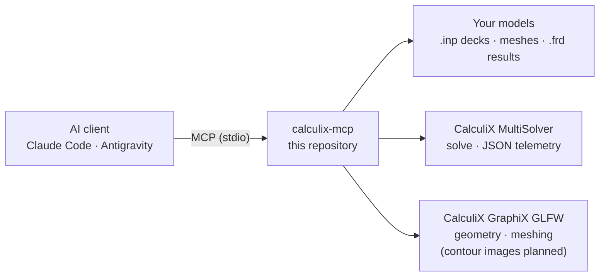

# calculix-mcp

[](https://github.com/carlomontec/calculix-mcp-rs/actions/workflows/ci.yml)
[](https://www.rust-lang.org/)
[](https://modelcontextprotocol.io/)
[](http://www.calculix.de/)
[](LICENSE)

**Let an AI agent work on real CalculiX models.** `calculix-mcp` is a Model Context Protocol server that gives Claude, Antigravity or any MCP client direct access to your finite-element work: it builds geometry and meshes through CalculiX GraphiX, reads decks with their whole `*INCLUDE` tree and edits them into new files, checks the mesh, selects faces and finds contact pairs, runs the solver in the background, explains convergence problems, and quotes exact results with node ids from ASCII or binary `.frd` files.

It is written in Rust, works on the decks and result files you already have, and never asks the model to estimate a number it can compute. The repository also includes [`cgx-top`](#cgx-top-results-in-your-terminal), a small terminal tool for checking results by hand.



## Part of a CalculiX toolchain

`calculix-mcp` is one of three projects that together give CalculiX a modern, scriptable workflow:

| Project | Role |
|---|---|
| **calculix-mcp-rs** (this repository) | The MCP server and the Rust library behind it: deck inspection, mesh checks and face selection, solver jobs, convergence diagnosis, result queries |
| [**CalculiX MultiSolver**](https://github.com/carlomontec/CalculiX-CrunchiX-MultiSolver) | A multi-platform edition of the CalculiX solver (CrunchiX) with selectable sparse solvers (MUMPS, Apple Accelerate, PARDISO, SPOOLES) and JSON run telemetry, which `calculix-mcp` reads to report each solve |
| [**CalculiX GraphiX GLFW**](https://github.com/carlomontec/CalculiX-GraphiX-GLFW) | A multi-platform edition of the CalculiX pre- and post-processor (GraphiX) on GLFW, whose batch mode `calculix-mcp` runs to build geometry and meshes, and whose command channel will let it render contour plots |

## What a session looks like

Condensed from a real Claude Code session on the 7-sector compressor rotor benchmark (a 74,000-line deck and a 409 MB result file). The numbers are the server's output.

> **You:** Is the rotor deck sound, and what did the last run give?
>
> **Agent** calls `inp_inspect`, `mesh_check` and `frd_summary`, then answers:
>
> The deck is a cyclic-symmetry model (`*CYCLIC SYMMETRY MODEL, N=7`) in 5 files with no missing includes: a static preload step at line 47, then a perturbation frequency step at line 57.
> The mesh is one connected part of 10,816 C3D20R elements with no free nodes and no inverted elements; volume 8,130.8 and mass 2.15e-5 in deck units. The worst aspect ratio is 26.7, at elements 7888 and 7904.
> The result file holds the full 342,139-node expansion. Modes 1, 3 and 5 at nodal diameter 5 are at 8,310, 11,052 and 15,321. Their stress peaks are normalised mode-shape amplitudes, not physical stresses.

Other things you can ask:

| You say | The agent uses |
|---|---|
| "Show me the frequency step and the boundary conditions of this deck." | `inp_cards` |
| "Any free nodes or disconnected parts? What is the mass per material?" | `mesh_check` |
| "Mesh a 100 × 20 × 10 block with 20-node hexes and check it." | `cgx_help`, `cgx_run_batch`, `mesh_check` |
| "Save the upward-facing faces above z = 40 as a surface called TOP." | `mesh_select` |
| "Which parts touch each other? Write the contact surfaces." | `mesh_contact_pairs` |
| "Request 12 modes instead of 5 and show me the diff." | `inp_edit` |
| "Solve it with MUMPS on 8 threads and tell me when it is done." | `ccx_solve`, `ccx_job_status` |
| "My contact job keeps cutting back. Why?" | `ccx_diagnose` |
| "Peak von Mises on set BLADE_ROOT in every step, and the five worst nodes with coordinates." | `frd_query_set` |

Full transcripts with the raw tool output are in [`crates/calculix-mcp/README.md`](crates/calculix-mcp/README.md).

## Highlights

- Works on existing decks: the whole `*INCLUDE` tree, cyclic symmetry, modal results with mode number and nodal diameter.
- Reads large ASCII and binary `.frd` files lazily; a 409 MB file is summarised in well under a second.
- Solves on a private copy of the deck and always cleans up its processes.
- Builds geometry and meshes through CalculiX GraphiX, finds contact pairs, and edits decks only by writing new files.
- Returns exact values with node ids, plus notes when a number needs context.

## Install and connect

### 1. Build

```bash
git clone https://github.com/carlomontec/calculix-mcp-rs.git
cd calculix-mcp-rs
cargo build --release -p calculix-mcp
```

The server is `target/release/calculix-mcp`. You need a Rust toolchain, and for solving, either stock CalculiX (`ccx`, for example from your distribution's package) or a build of [CalculiX MultiSolver](https://github.com/carlomontec/CalculiX-CrunchiX-MultiSolver). MultiSolver is recommended: it writes JSON telemetry (per-step convergence flags, solver name, timings, mode tables) that makes job status and diagnosis richer. With stock CalculiX, progress and diagnosis use the `.sta` and `.cvg` files only. Every other tool works without a solver.

### 2. Connect your AI client

Two flags matter: `--root` is the folder with your models (`.inp` decks, their include files and `.frd` results, subfolders included); the server may read everything under it and only ever adds new files there, and `--ccx NAME=PATH` registers a solver binary, stock `ccx` or a MultiSolver build. At startup the server checks which one it is and logs it to stderr; a MultiSolver binary is run as `-j <job>` and a stock one as `-i <job>`. Repeat `--ccx` to offer several (for example `accelerate`, `spooles`, `mumps`, or `ccx=/usr/bin/ccx`); the first is the default. Add `--cgx PATH` (a CalculiX GraphiX binary, for example the GLFW edition) to enable geometry and meshing. Use absolute paths.

**Claude Code**: register once from a terminal:

```bash
claude mcp add calculix -- /abs/path/to/calculix-mcp --root /abs/path/to/my-models --ccx mumps=/abs/path/to/CalculiX
```

or put this in a `.mcp.json` file at the root of your project, to share the setup with the project:

```json
{
  "mcpServers": {
    "calculix": {
      "type": "stdio",
      "command": "/abs/path/to/calculix-mcp",
      "args": ["--root", "/abs/path/to/my-models", "--ccx", "mumps=/abs/path/to/CalculiX"]
    }
  }
}
```

Check that it is connected with `/mcp` inside Claude Code.

**Antigravity**: add the same `mcpServers` block to `~/.gemini/config/mcp_config.json`, then reload the MCP servers in Antigravity.

Claude Desktop reads the same block from its `claude_desktop_config.json`; this setup has not been tested yet.

### 3. Talk to it

Ask in plain language; the agent picks the tools. Paths are relative to `--root`.

```text
What does run/bracket.inp do? Any missing includes?
Check the mesh of run/bracket.inp before I solve it.
Save the bolt hole along z through (40, 0), radius 6, as a surface called BORE.
Solve run/bracket.inp with mumps and tell me when it is done.
What is the peak von Mises stress on set FILLET, and at which nodes?
```

The server never edits your deck: selections go to new include files, and solves run on a copy in `<root>/.calculix-mcp/runs/`.

### Platforms

On Debian and Ubuntu, stock CalculiX is the `calculix-ccx` package (binary `/usr/bin/ccx`, so `--ccx ccx=/usr/bin/ccx`). The configuration is the same JSON on every operating system; only file locations and path syntax differ (on Windows, write paths in JSON as `C:/cases` or `C:\\cases`). The server is developed and tested on macOS. Linux uses the same mechanisms and is expected to work but has not been tested yet. On Windows it is untested, and stopping a solver ends only its direct process, not the processes it started.

All flags are documented in the [server README](crates/calculix-mcp/README.md#run-and-flags).

## Tools

| Stage | Tool | What it does |
|---|---|---|
| Decks | `inp_inspect` | Summary of a deck across its `*INCLUDE` tree: flags, keyword census, step plan, includes, sets, materials |
| | `inp_cards` | Specific keyword cards with file, line and data lines, without loading the whole deck |
| | `inp_consolidate` | Flatten a multi-file deck into one file |
| | `inp_edit` | Located edits (parameters, data lines, cards, steps) written to new files, with a diff and a re-check |
| Geometry | `cgx_run_batch` | Run a CalculiX GraphiX script headlessly to build geometry and meshes; returns the files and a mesh summary |
| | `cgx_help` | CalculiX GraphiX command reference with verified examples |
| Mesh | `mesh_check` | Parts, free nodes, inverted elements, aspect ratios, volume, mass and centre of gravity, undefined or empty sets |
| | `mesh_select` | Select exterior faces by geometry and save them as a `*SURFACE` or `*NSET` include file |
| | `mesh_contact_pairs` | Find faces of different parts that face each other within a gap; save slave and master surfaces and a contact-card template |
| Solve | `ccx_solve` | Start a background solve on a private copy of the deck |
| | `ccx_job_status` | State, progress, memory, convergence verdict and result files; waits for a change instead of polling |
| | `ccx_job_cancel` | Stop a job and every process it started |
| | `ccx_job_list` | Recent and past jobs with state and run-directory size |
| | `ccx_diagnose` | Explain convergence from `.sta`, `.cvg` and `.json` |
| Results | `frd_summary` | Steps, frequencies, fields and whole-model peaks with node ids |
| | `frd_sets` | Node and element sets available for queries |
| | `frd_query_set` | Exact stress invariants or displacement extrema on one set, per step, with the most loaded nodes |

## Built to be trusted

- **Confined.** Every path must resolve inside `--root`; `..` and symlink escapes are rejected.
- **Read-only by default.** Decks are never edited. Selections are written to new include files, and solves run in `<root>/.calculix-mcp/runs/<job_id>/`.
- **No shell.** The solver is started with an explicit argument vector, from a binary named at startup, with a cleared environment.
- **No orphans.** Cancel, timeout and client disconnect end with the solver's whole process group gone, including processes that ignore SIGTERM. After a server crash, the next start finds and stops orphaned solvers.
- **Honest output.** Results carry notes when a number needs context: deck units, normalised mode shapes, upper-bound amplitudes, heuristic thresholds.

## Performance

Release build, open plus stress and displacement histories over the whole model:

| Result file | Full parse | Lazy index (`calculix-mcp`) | Peak memory, full to lazy |
|---|---|---|---|
| Compressor rotor, 409 MB ASCII, 342,139 nodes | 1.97 s | 0.62 s | 808 MB to 456 MB |
| Hammering, 89 MB binary, 366,987 nodes | 1.06 s | 0.12 s | 365 MB to 191 MB |

## cgx-top: results in your terminal

The repository also ships `cgx-top`, a small terminal tool for checking results by hand: no AI client and nothing to configure, and it works over SSH. It uses the same Rust library as the server.

```bash
cargo build --release -p cgx-top

cgx-top results.frd                                 # interactive dashboard
cgx-top --summary results.frd                       # steps, fields, sets and extrema
cgx-top results.frd deck.inp -S BLADE_ROOT --mises  # von Mises history on a set (--principal, --disp, --csv)
cgx-top check deck.inp                              # include tree, sets, materials
cgx-top consolidate deck.inp                        # flatten *INCLUDE files into one deck
cgx-top diagnose run/job                            # convergence verdict from .sta and .cvg
```

The dashboard on a modal beam with step 3 selected (a capture of the real screen):

```text
╭────────────────────────────────────────────────────────────────────────────────────────────────────────────────────╮
│ cgx-top │ beam_modal.frd (237.19 KB) │ Nodes: 261 Elements: 32 Steps: 5 │ Set: [[ALL NODES]] (261 nodes (all))     │
╰────────────────────────────────────────────────────────────────────────────────────────────────────────────────────╯
╭ Steps / Modes / Loads (5) [W/S, 1-9╮╭ Step Extrema & Invariant Details [Tab: All Fields] ──────────────────────────╮
│  Step 1   (t=1.310e4) DISP         ││Step 3 │ Incr 1 │ Value: 7.693814e4 │ DISP │ Set: [[ALL NODES]] (261 nodes)  ◄│
│  Step 2   (t=1.310e4) DISP         ││A/D cycle (0=ALL) ►                                                           │
│▶ Step 3   (t=7.694e4) DISP         ││──────────────────────────────────────────────────────────────────────────────│
│  Step 4   (t=7.694e4) DISP         ││● NODAL DISPLACEMENT (Field: DISP)                                            │
│  Step 5   (t=9.357e4) DISP         ││   Peak Magnitude (ALL): 8.066241e3 at Node #8  (Min: 0.0000e0)               │
│                                    ││   D1    min: -5.5923e3    (Node #173  )  │  max: 7.5018e3     (Node #25)     │
│                                    ││   D2    min: -1.4282e3    (Node #7    )  │  max: 1.1808e3     (Node #55)     │
│                                    ││   D3    min: -2.6019e3    (Node #6    )  │  max: 2.6019e3     (Node #8)      │
│                                    ││   ALL   min: 0.0000e0     (Node #94   )  │  max: 8.0662e3     (Node #8)      │
│                                    ││                                                                              │
│                                    ││● CAUCHY STRESS & INVARIANTS (Field: STRESS)                                  │
│                                    ││   von Mises: 2.214251e8 at Node #2                                           │
│                                    ││   S1 (Max Principal): 3.6240e8     (#2)  │  S3 (Min Principal): -3.6240e8    │
│                                    ││(#4)                                                                          │
╰────────────────────────────────────╯╰──────────────────────────────────────────────────────────────────────────────╯
╭ Peak von Mises Stress History across Steps [Filter: [ALL NODES]] ──────────────────────────────────────────────────╮
│    3.25e8 ┤                                                                                               ╭─────   │
│           │                                                                                    ╭──────────╯        │
│           │                                                 ╭──────────────────────────────────╯                   │
│    1.86e8 ┤                                           ╭─────╯                                                      │
│           │                                    ╭──────╯                                                            │
│           │                              ╭─────╯                                                                   │
│    4.67e7 ┤ ─────────────────────────────╯                                                                         │
│           └─────────────────────────────────────────────────────────────────────────────────────────────────────   │
╰────────────────────────────────────────────────────────────────────────────────────────────────────────────────────╯
 [W/S] Step   [A/D] Rotate Set   [0] All Nodes   [1-9] Jump Step   [Space] Set List   [Tab] Field   [?] Help   [q/Esc]
```

| Key | Action |
|---|---|
| `W` / `S` or arrows | Previous / next step, mode or increment |
| `A` / `D` or arrows | Previous / next node set |
| `0` | Back to all nodes |
| `1` to `9` | Jump to step 1 to 9 |
| `Space` / `Enter` | Search and pick a set |
| `Tab` | Show all fields, displacement only or stress only |
| `g` / `G`, `PgUp` / `PgDn` | First / last step, 5 steps back / forward |
| `?` | Help |
| `q` / `Esc` | Quit |

Both tools are built on `cgx-core`, which can also be used as a library: lazy `.frd` index (ASCII and binary), `.inp` card scanner and mesh reader, exterior faces and selections, mesh checks, `.sta`/`.cvg` parsers with the convergence rules, and stress invariants.

## Roadmap

- [x] Deck inspection, mesh checks and face selection
- [x] Background solver jobs with cleanup, quota and crash recovery
- [x] Convergence diagnosis from `.sta` and `.cvg`
- [x] Solving with stock CalculiX and with CalculiX MultiSolver
- [x] Exact result queries on large ASCII and binary `.frd` files, including cyclic-symmetry modes
- [x] Contact pair detection between parts
- [x] Located, reviewable deck edits written to new files with a diff
- [x] Geometry and meshing through CalculiX GraphiX batch scripts
- [x] CI on Linux, macOS and Windows, with an end-to-end solve
- [ ] Contour images rendered by CalculiX GraphiX
- [ ] `cgx-top --watch`: live view of a running solve
- [ ] Windows process-tree handling for cancelled solves

Limitations and design notes: [server README](crates/calculix-mcp/README.md#limitations), [`docs/`](docs).

## License

MIT. See [LICENSE](LICENSE).
