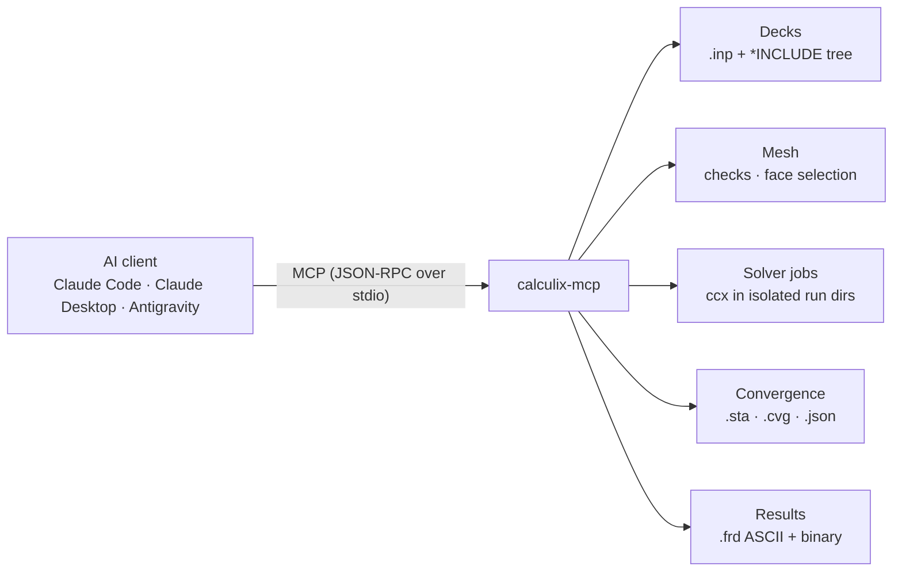

# calculix-mcp

[](https://www.rust-lang.org/)
[](https://modelcontextprotocol.io/)
[](http://www.calculix.de/)
[](LICENSE)

**Let an AI agent work on real CalculiX models.** `calculix-mcp` is a Model Context Protocol server that gives Claude, Antigravity or any MCP client direct access to your finite-element work: it reads decks with their whole `*INCLUDE` tree, checks the mesh, selects faces by geometry, runs the solver in the background, explains convergence problems, and quotes exact results with node ids from ASCII or binary `.frd` files.

It is written in Rust, works on the decks and result files you already have, and never asks the model to estimate a number it can compute.



## What a session looks like

Condensed from a real Claude Code session on the 7-sector compressor rotor benchmark (a 74,000-line deck and a 409 MB result file). The numbers are the server's output.

> **You:** Is the rotor deck sound, and what did the last run give?
>
> **Agent** calls `inp_inspect`, `mesh_check` and `frd_summary`, then answers:
>
> The deck is a cyclic-symmetry model (`*CYCLIC SYMMETRY MODEL, N=7`) in 5 files with no missing includes: a static preload step at line 47, then a perturbation frequency step at line 57.
> The mesh is one connected part of 10,816 C3D20R elements with no free nodes and no inverted elements; volume 8,130.8 and mass 2.15e-5 in deck units. The worst aspect ratio is 26.7, at elements 7888 and 7904.
> The result file holds the full 342,139-node expansion. Modes 1, 3 and 5 at nodal diameter 5 are at 8,310, 11,052 and 15,321. Their stress peaks are normalised mode-shape amplitudes, not physical stresses.

Other things you can ask:

| You say | The agent uses |
|---|---|
| "Show me the frequency step and the boundary conditions of this deck." | `inp_cards` |
| "Any free nodes or disconnected parts? What is the mass per material?" | `mesh_check` |
| "Save the upward-facing faces above z = 40 as a surface called TOP." | `mesh_select` |
| "Solve it with MUMPS on 8 threads and tell me when it is done." | `ccx_solve`, `ccx_job_status` |
| "My contact job keeps cutting back. Why?" | `ccx_diagnose` |
| "Peak von Mises on set BLADE_ROOT in every step, and the five worst nodes with coordinates." | `frd_query_set` |

Full transcripts with the raw tool output are in [`crates/calculix-mcp/README.md`](crates/calculix-mcp/README.md).

## Why it is different

Most CalculiX automation drives a small generated model: write a template deck, run it, print a few values. `calculix-mcp` is built for the models engineers actually have:

- **Real decks.** Follows the whole `*INCLUDE` tree, reports the step plan, sets, materials and missing files, and reads any keyword card with its file and line.
- **Cyclic symmetry and modal results.** Recognises `*CYCLIC SYMMETRY MODEL`, and result steps carry mode number and nodal diameter.
- **Large and binary result files.** `.frd` files are indexed lazily and only the requested dataset is read; a 409 MB file is summarised in well under a second.
- **Preprocessing support.** Mesh checks (parts, free nodes, inverted elements, aspect ratio, volume, mass, centre of gravity, undefined sets) and face selection by direction, plane, box, cylinder, proximity or connected patch, saved as `*SURFACE` or `*NSET` include files.
- **Solver jobs that clean up after themselves.** Each solve runs on a private copy of the deck in its own process group, with timeout, disk quota, cancellation and crash recovery. Your original directory is never written to.
- **Convergence diagnosis.** Reads `.sta` and `.cvg` and classifies a run as linear, smooth, slow, contact chattering, cutback loop or diverging, with the evidence and the next thing to check.
- **Exact values with node ids.** Von Mises, principal, Tresca, hydrostatic and displacement extrema per set and per step, with the responsible nodes and their coordinates.

## Quick start

```bash
git clone https://github.com/carlomontec/calculix-mcp-rs.git
cd calculix-mcp-rs
cargo build --release -p calculix-mcp
```

Register it with Claude Code:

```bash
claude mcp add calculix -- /abs/path/to/target/release/calculix-mcp --root /abs/path/to/cases --ccx mumps=/abs/path/to/CalculiX
```

Or add it to `.mcp.json` (Claude Code), `claude_desktop_config.json` (Claude Desktop) or `~/.gemini/config/mcp_config.json` (Antigravity):

```json
{
  "mcpServers": {
    "calculix": {
      "command": "/abs/path/to/target/release/calculix-mcp",
      "args": ["--root", "/abs/path/to/cases", "--ccx", "mumps=/abs/path/to/CalculiX"]
    }
  }
}
```

`--root` limits the directories the server may touch. `--ccx NAME=PATH` registers a solver; repeat it to offer several builds (for example `accelerate`, `spooles`, `mumps`). Solving currently requires the CalculiX MultiSolver fork, which writes JSON telemetry with `-j`; every other tool works without any solver installed. All flags are documented in the [server README](crates/calculix-mcp/README.md#run-and-flags).

## Tools

| Stage | Tool | What it does |
|---|---|---|
| Decks | `inp_inspect` | Summary of a deck across its `*INCLUDE` tree: flags, keyword census, step plan, includes, sets, materials |
| | `inp_cards` | Specific keyword cards with file, line and data lines, without loading the whole deck |
| | `inp_consolidate` | Flatten a multi-file deck into one file |
| Mesh | `mesh_check` | Parts, free nodes, inverted elements, aspect ratios, volume, mass and centre of gravity, undefined or empty sets |
| | `mesh_select` | Select exterior faces by geometry and save them as a `*SURFACE` or `*NSET` include file |
| Solve | `ccx_solve` | Start a background solve on a private copy of the deck |
| | `ccx_job_status` | State, progress, memory, convergence verdict and result files; waits for a change instead of polling |
| | `ccx_job_cancel` | Stop a job and every process it started |
| | `ccx_job_list` | Recent and past jobs with state and run-directory size |
| | `ccx_diagnose` | Explain convergence from `.sta`, `.cvg` and `.json` |
| Results | `frd_summary` | Steps, frequencies, fields and whole-model peaks with node ids |
| | `frd_sets` | Node and element sets available for queries |
| | `frd_query_set` | Exact stress invariants or displacement extrema on one set, per step, with the most loaded nodes |

## Built to be trusted

- **Confined.** Every path must resolve inside `--root`; `..` and symlink escapes are rejected.
- **Read-only by default.** Decks are never edited. Selections are written to new include files, and solves run in `<root>/.calculix-mcp/runs/<job_id>/`.
- **No shell.** The solver is started with an explicit argument vector, from a binary named at startup, with a cleared environment.
- **No orphans.** Cancel, timeout and client disconnect end with the solver's whole process group gone, including processes that ignore SIGTERM. After a server crash, the next start finds and stops orphaned solvers.
- **Honest output.** Results carry notes when a number needs context: deck units, normalised mode shapes, upper-bound amplitudes, heuristic thresholds.

## Performance

Release build, open plus stress and displacement histories over the whole model:

| Result file | Full parse | Lazy index (`calculix-mcp`) | Peak memory, full to lazy |
|---|---|---|---|
| Compressor rotor, 409 MB ASCII, 342,139 nodes | 1.97 s | 0.62 s | 808 MB to 456 MB |
| Hammering, 89 MB binary, 366,987 nodes | 1.06 s | 0.12 s | 365 MB to 191 MB |

## Also in this repository

The server is built on a Rust workspace that can be used on its own:

| Crate | Purpose |
|---|---|
| [`calculix-mcp`](crates/calculix-mcp) | The MCP server |
| `cgx-core` | Library: lazy `.frd` index (ASCII and binary), `.inp` card scanner and mesh reader, exterior faces and selections, mesh checks, `.sta`/`.cvg` parsers and convergence rules, stress invariants |
| `cgx-top` | Terminal companion to CalculiX GraphiX: result summaries, set queries with CSV output, deck checks, convergence diagnosis and an interactive TUI |

```bash
cgx-top --summary results.frd                      # steps, fields, extrema
cgx-top results.frd deck.inp -S BLADE_ROOT --mises # von Mises history on a set
cgx-top diagnose run/job                           # convergence verdict from .sta/.cvg
```

## Roadmap

- [x] Deck inspection, mesh checks and face selection
- [x] Background solver jobs with cleanup, quota and crash recovery
- [x] Convergence diagnosis from `.sta` and `.cvg`
- [x] Exact result queries on large ASCII and binary `.frd` files, including cyclic-symmetry modes
- [ ] Contact pair detection between parts
- [ ] Located, reviewable deck edits written to a new file with a diff
- [ ] Geometry and meshing through CalculiX GraphiX batch scripts
- [ ] Contour images rendered by CalculiX GraphiX
- [ ] Solving with stock CalculiX, Windows process handling, CI

Limitations and design notes: [server README](crates/calculix-mcp/README.md#limitations), [`docs/`](docs).

## License

MIT. See [LICENSE](LICENSE).
